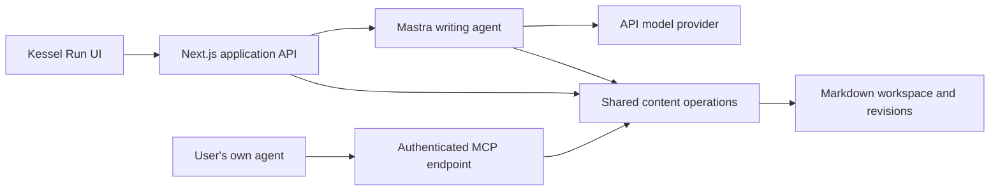

# Plan 017: Finish the writing app with API-key AI and external-agent MCP

> **Executor instructions:** Implement the phases in order, with a reviewable
> commit and recorded evidence after each. Both entry paths share the same
> content operations. No subscription integration, hosted deployment, publishing,
> remote push or personal-workspace migration is authorized by this plan.
>
> **Drift check:** `git diff --stat 9782fb8..HEAD -- package.json package-lock.json next.config.ts vitest.config.ts playwright.config.ts .gitignore .env.example src scripts docs tests artifacts plans`
> Compare changed files with the scope and current-state evidence below. Changes
> made by an earlier phase are expected; reconcile unrelated changes first.

## Status and decisions

- **State:** Implementation checkpoints complete; release acceptance remains pending browser/E2E, live API, real Codex and human editorial validation. See docs/kessel-run-app.md for technical evidence and remaining gates.
- **Priority:** P1
- **Effort:** L — multiple implementation and review checkpoints.
- **Risk:** HIGH — credentials, concurrent human/agent edits, durable content,
  and two clients operating on the same workspace.
- **Depends on:** 009–012, 015 and 016 are merged. 016's browser acceptance is
  unverified; reuse its design, not its acceptance claims.
- **Category:** direction / architecture / UI / reliability
- **Planned at:** `9782fb8d457becb9dd5d333f3ad2c13e45f0bff4`, 2026-10-13.
- **Latest user decision:** API keys power AI inside Kessel Run. MCP lets users
  update Kessel Run through their own agent. Sign in with ChatGPT is deferred
  until a future supported integration is selected; it is not a release dependency.
- **Scope assumption:** Retain the agreed local-first validation release and
  bring-your-own credentials. Start with OpenAI, matching the existing provider;
  leave an adapter boundary for other API providers rather than implementing all.
- **Known evidence:** The user generated The Greatest Ever Reviews' starter
  profile and reported success. Import it instead of repeating voice setup.
  Drafting, editing, learning, resume and app usability still need validation.

This revision replaces the earlier subscription-backed Codex proposal under the
same plan number. Codex installation, app-server supervision, subscription OAuth,
generated Codex protocol bindings and subscription eligibility gates are removed.

## Why this matters

The skills describe the intended writing method, but the app exposes an older
single-draft pipeline. The HTML mockup demonstrates publications, voices and
independent outputs without real persistence. Finish those workflows so the user
can validate real writing inside the app, while external agents can manipulate
the same saved work through MCP.

## Product contract

| Mode | Where the conversation happens | Who runs inference | Required credential |
| --- | --- | --- | --- |
| In-app AI | Kessel Run writing panel | Kessel Run server through the API provider | User's configured API key |
| External agent | Codex or another compatible MCP client | The user's agent, under its own provider/account | Scoped Kessel Run MCP access token; no Kessel Run model key |
| Manual editing | Kessel Run | No inference | Local app session only |

MCP operations do not invoke an LLM, call back into in-app chat, or incur an app
model request. External agents bring generated prose to the tools. The app does
not receive their provider credentials or promise compatibility with every host.
Do not expose a generic `generate_content` tool that charges the app's API key.

“Finished” for the local release means the user can import a voice, create a
piece, supply notes, draft through either AI mode, edit, approve final prose,
review lessons, restart/resume, add another output and export Markdown. Manual
editing, export and MCP continue to work with no model key configured.

Deferred: Sign in with ChatGPT/subscription auth, hosted SaaS and tenant accounts,
payments, teams, remote MCP OAuth, public deployment, arbitrary API base URLs,
automatic publishing, Oracle, URL crawling, dictation and desktop installers.
Supplied text/Markdown is enough for this release. A URL without retrieved text
is a reference, not evidence the app or agent has read.

## Current state and conventions

| Location | Current evidence | Required change |
| --- | --- | --- |
| `src/mastra/agents/kessel-run-agent.ts:24` | `model: 'openai/gpt-5'`; skill resolver and working memory | Reuse Mastra; resolve a validated model/credential server-side for each run |
| `src/mastra/projects/schema.ts:43–69` | One pipeline stage and one draft | Separate publication, piece, output, profile and revision entities |
| `src/mastra/projects/store.ts:77` | Working-memory parse failure becomes empty state | New storage reports corruption without discarding work |
| `src/lib/kessel-run/session.ts:9` | Same `kessel-run-local-user` for every request | New APIs bind explicit local session/workspace/client scope |
| `src/app/api/kessel-run/projects/[projectId]/chat/route.ts:38` | `handleChatStream`, `...body` spread, AI SDK v5/v7 cast | Validate new request fields and verify actual streaming compatibility |
| `src/components/kessel-run/project-chat.tsx:65–77` | AI SDK chat; refresh only on turn completion | Save events, stop, reconnect, scoped history and useful error states |
| `src/app/kessel-run/page.tsx` | Skill gallery and project list | Publication overview and writing workspace |
| `src/mastra/skills/catalog.ts` | 15 skills; eight numbered, seven standalone | Keep canonical methods; Start/Resume is the default entry point |
| `src/mastra/skill-references/workspace.md` | Markdown contract, independent outputs and profile pins | Implement these invariants in the shared service |
| `artifacts/kessel-run-app.html` | Polished but in-memory publication/voice/editor concept | Port to React with real persistence and AI |
| `src/mastra/index.ts` | Mastra storage and DuckDB observability bootstrap | Do not make MCP/manual operations initialize a model or require a model key |

Representative existing patterns to preserve:

```ts
// src/mastra/projects/store.ts — ownership checked on the server
if (!thread || thread.resourceId !== resourceId) return null;

// src/mastra/projects/schema.ts — the current limitation
draft: z.string().nullable(),
```

Installed Mastra types support a dynamic model configuration and an `apiKey`
option (`node_modules/@mastra/core/dist/agent/agent.d.ts` and
`dist/llm/model/shared.types.d.ts`). Check the installed APIs before wiring the
adapter. Never place a secret in agent-visible context, shared mutable globals,
tool arguments or logs. Prefer a per-run model/agent factory with server-only
credentials while reusing canonical instructions and skill resolution.

Keep Zod validation, small route adapters, existing React/shadcn/Base UI
primitives and Vitest. Preserve old project URLs and data; do not silently migrate
Mastra working-memory records. The new content service is provider-independent.

## Architecture



Run a normal local Next.js Node server. No Codex process or separate agent
supervisor is needed. Agent tools, UI routes and MCP adapters call the same domain
operations. Conversations help the agent work; they are not a second authoritative
copy of editorial state.

Expose MCP at `/api/mcp` using a maintained Next route adapter. Current official
[Vercel mcp-handler guidance](https://vercel.com/changelog/latest-mcp-spec-now-supported-in-mcp-handler)
documents a stateless v2 handler with 2025 Streamable HTTP compatibility, Node 20+
and Zod 4. It uses `@modelcontextprotocol/server`, not the older SDK package.
Recheck and pin a compatible package set during implementation. Do not combine
v1 and v2 examples or introduce Redis/deprecated SSE just to support local MCP.

Bind the app to loopback for this release. Use an authenticated browser session
for UI APIs and separate scoped bearer tokens for MCP. Scope is derived from
credentials, never a caller-provided owner ID. Add exact Host/Origin checks and
CSRF protection to browser mutations; MCP authentication applies on every call.
Do not install client configuration or modify global agent settings automatically.

### API keys and models

Start with OpenAI API-key support. Users may select a server-side environment
configuration or enter their own key through a local settings form. Credential
setup is separate from ordinary chat requests: submit the secret once to the
authenticated local server, clear it from the form, and retain only an opaque
credential reference and masked status in the UI. Never use `NEXT_PUBLIC_*`,
browser storage, exported workspace files or chat transcripts to store keys.
OpenAI's [API authentication guidance](https://developers.openai.com/api/reference/overview)
requires secret keys to remain protected on the server.

Persist user-entered keys in OS credential storage where supported, otherwise
an explicitly documented owner-only local store outside the workspace. Support
replace/remove; never return the full key. Do not read or expose an existing
`.env` value during implementation. Show the selected credential source clearly;
an invalid or exhausted user key must not fall back to another key or provider.

The model picker lists supported text/tool-capable models for the configured
provider. Keep model discovery/configuration server-side; do not equate a general
model catalog with proven tool compatibility. Record the provider/model used per
run. A small user-triggered connection test may make a billed request and must
say so; ordinary status checks must not make hidden generation calls.
Display provider-reported usage where available, not invented cost estimates.
Bound input sizes, tool steps, generation length and duration. Do not retry
non-idempotent writes or replay an ambiguous generation silently after timeout.

## Shared content model and persistence

| Entity | Invariant |
| --- | --- |
| Workspace | Stable ID, user-selected root and schema version |
| Publication | Identity, audience/purpose, default voice and output presets |
| Voice version | Profile ID/version, publication or author scope, approval, evidence maturity, readable rules/provenance; author pins its parent |
| Piece | Topic/brief, publication, sources, guided/fast mode, decisions/next action |
| Source | Supplied text, attribution/type, optional reference URL and revision/hash |
| Output | Piece/format, complete profile selections, independent status and revision |
| Revision | Immutable prose, human/model/external-agent provenance, parent revision and exact selected context |
| Proposal/decision | Exact target/revision, evidence, pending/accepted/rejected state and human decision |
| Run | Workspace/output or voice-setup scope, engine, model if known, history, tool events and terminal status |

Voice setup can run without a piece. A piece has many independent outputs. An
output may have many conversations, including work performed by an external
agent; do not require that agent's private chat history or pretend it is visible.

Use the established readable files: `Kessel Run.md`, publications/profiles,
`Brief.md`, source notes, `Outputs/<name>/Output.md`, and retained draft/final
versions linked relatively. Editorial Markdown is canonical; any index is
rebuildable. Private run records, access tokens and operation journals stay
outside exported content. Credentials are never part of context or exports.

Every mutation needs an operation ID and expected revision/hash. Serialize
writes through a cross-process workspace lock: Next development workers, MCP
and HTTP requests must not bypass it through module-local locks. Retried identical
operations return their original result; reusing an ID with different arguments
fails. Stale writes return `CONFLICT` and preserve both texts.

Use immutable revision/profile files, atomic pointer changes and a small durable
journal. Recover interrupted multi-file changes before accepting new writes;
never acknowledge partially committed data. External Markdown edits invalidate
hashes and trigger conflicts. Preserve unknown frontmatter and body sections.
Reject path traversal/symlink escapes, duplicate IDs and unresolved version pins.
Never replace missing old voice rules with today's default or treat corruption
as an empty workspace.

Start with a new app-managed workspace and explicit import. Preserve supplied
profile prose verbatim; preview added IDs/version metadata and ask the user to
confirm its use. Sparse approved profiles are valid. Do not seed mockup rules,
sample authors or fictional source evidence as real user data. Existing vault
files, `Issue.md` and old app projects are not automatically rewritten.

### Editing and approval

UI edits save with revision checks and visible saving/saved/conflict states.
Keep a recovery buffer on failed saves. The agent proposes immutable draft
revisions and appends sourced answers; it cannot overwrite intervening human
edits. Streamed text is provisional until saving succeeds, and interrupted text
is labeled. Retain the exact machine draft before human edits and the exact
accepted final separately.

Profile approval, final-prose acceptance and lesson approval are separate
decisions. Tools can create proposals but cannot manufacture human approval.
Accepting selected lessons creates a new voice version; earlier outputs keep
their pins. Author lessons stay scoped to that author. Any prose edit invalidates
acceptance tied to the old revision; a scorecard cannot become final prose.

## Shared tools, including external MCP

Implement domain functions once. Mastra wraps them as native agent tools; MCP
wraps the same functions for external clients. Avoid an internal MCP network hop
just to call a function in the same app.

| Operation | Behavior |
| --- | --- |
| `kr_list_publications`, `kr_list_pieces` | Paginated, scoped summaries |
| `kr_get_context` | Exact selected voice/author snapshots, brief, required sources, current output and pending decisions; bounded/paginated |
| `kr_get_workflow` | Allowlisted canonical skill with needed bundled references and content hash |
| `kr_create_piece`, `kr_create_output` | Create within granted publication/piece scope; independent output pins |
| `kr_save_source` | Append supplied notes/interview material with attribution; no fictional retrieval |
| `kr_save_artifact` | Allowlisted research/anchor/hook/outline/review artifacts, separate from prose |
| `kr_propose_draft` | Save generated candidate with expected editor revision and declared agent provenance |
| `kr_propose_profile` | Publication/author draft rules with evidence and exact parent versions |
| `kr_propose_lessons` | Proposed rules from a specific retained machine/final comparison pair |
| `kr_record_progress` | Preserve next action and existing decisions; cannot create editorial approval |

No arbitrary filesystem paths, SQL, shell, provider configuration or unrestricted
URL fetching. Return structured IDs/revisions, changed entities and user-openable
app links. Use stable errors: `NOT_FOUND`, `CONFLICT`, `INVALID_INPUT`,
`MISSING_PROFILE_VERSION`, `APPROVAL_REQUIRED`, `CAPABILITY_UNAVAILABLE`.

MCP connection setup lets the user choose workspace/publication scope and whether
to allow draft/source mutations. Issue separate revocable tokens per client,
display the secret once and store only its hash plus grant metadata. Tokens are
not provider keys. Never expose provider credentials or in-app generation routes
as MCP tools. In-app approval screens remain the authority for profile/final/
lesson acceptance in v1; the external agent can submit proposals and read decisions.

Show **Connect your agent** with endpoint, supported transport, scope and client
configuration instructions. Verify one real Codex client plus a standards-based
SDK client; do not claim untested hosts work. A local URL only works for a client
that can reach that machine. Cloud-hosted agents need a future deployment or
separately authorized connection; do not automatically publish/tunnel the server.

After any committed mutation, both UI and MCP reads return the same revision.
Provide a workspace version/change feed to refresh the app while an external
agent works, including when no in-app chat is active. Test cross-client races.

## Scope

Allowed implementation areas (new files where absent):

- `src/server/kessel-run/**`: `local-session.ts`,
  `workspace/{schema,files,lock,journal,service,import-export}.ts`,
  `ai/{provider,credentials,agent,run-store,events}.ts`,
  `mcp/{server,tools,access-tokens}.ts`, `skills/context.ts`, colocated tests.
- `src/lib/kessel-run/{local-api,app-contracts}.ts` (new client/DTO modules).
- `src/app/api/kessel-run/local/**/route.ts` and `src/app/api/mcp/route.ts` (new,
  validated operations, Node runtime). No unrestricted proxy route.
- `src/app/kessel-run/page.tsx` plus new settings/publication/voice/piece/output
  routes and layout; `src/components/kessel-run/app/**`; scoped tokens in
  `src/app/globals.css`; `src/app/page.tsx` landing redirect.
- `src/mastra/agents/kessel-run-agent.ts` for extracting reusable instructions/
  skill wiring, `src/mastra/index.ts` only for required bootstrap/trace isolation.
  Do not migrate legacy state or force new calls through its old memory schema.
- Old `src/app/api/chat/route.ts`, project API routes/pages and session helper
  only for local-session/explicit legacy-access guards; preserve URLs/data.
- Canonical workspace reference, new `app-runtime.md` reference, skill runtime
  capability clauses and their generated copies; sync script/tests if needed.
- `scripts/kessel-run-local.mjs`, `scripts/smoke-kessel-run-api.mjs` (new),
  `package.json`, lockfile, Next/Vitest config, `.gitignore`, `.env.example`.
- New Playwright config, `tests/e2e/**`, synthetic `tests/fixtures/kessel-run/**`.
- README, `docs/kessel-run-app.md`, `docs/kessel-run-mcp.md`, workspace/writing-flow
  docs, this plan and index.

Do not modify vendored AI Elements, the old prototype, mockup artifacts, personal
content, global agent config, or add subscription/hosted infrastructure. New
dependencies are limited to compatible MCP server/Next adapter/client testing,
provider integration if needed, secure credential storage, YAML parsing and
browser testing. No second agent framework or rich-text/desktop rewrite.

## Commands and baseline

The planning baseline on 2026-10-13 at `9782fb8` remains:

| Command | Observed / expected |
| --- | --- |
| `npm test` | 9 files / 53 tests passed before this plan revision |
| `npm run typecheck -- --incremental false` | Passed |
| `npm run lint` | 0 errors, 9 pre-existing warnings |
| `npm run skills:check` | 15 references passed |
| `npm run build` | Exists; not run during planning; required in executor worktree |
| `git diff --check` | Must pass for every phase |

System Git currently stops at an Xcode license prompt; recon used existing Git
at `/Users/miniying/.cache/codex-runtimes/codex-primary-runtime/dependencies/bin/fallback/git`.
Use a working Git without accepting an SDK license on the user's behalf.
No API key or live model test is needed to plan. No subscription login or Codex
binary is needed to run the app.

Add `app:dev` / `app:start` for loopback dev/production launch with a single-use
local pairing exchange and HttpOnly, SameSite=Strict session cookie. Pairing,
MCP tokens and API keys are distinct. Keep private state ignored. Add
`app:smoke:api` for an explicit small billed synthetic test and `test:app:e2e`
for deterministic browser tests with a fake provider and temporary workspace.
These scripts are proposed, not existing verified commands.

Before writing code, read installed Next route-handler, data-security,
authentication and backend-for-frontend guides in `node_modules/next/dist/docs/`.
Use the existing Emil design engineering/better-ui direction for UI work.

## Phase 1 — Prove API-key chat and a shared content operation

Implement a minimal local-session boundary, provider/credential adapter and
connection/settings view. Bind to loopback; protect data and mutation routes
before handling credentials. Support the selected environment key or saved user
credential explicitly; never silently switch between them. Model selection and
all model settings are validated on the server.

Reuse Mastra's installed agent APIs and canonical skills. Prove streaming,
one fixture-reading tool and one candidate-saving operation, request cancellation
and persisted conversation reload in a synthetic workspace. New request schemas
allow only message/scope/model/mode/operation ID; no `...body` runtime configuration.
Test AI SDK v5/v7 stream compatibility, not just TypeScript casts. Retain server
AbortControllers for active runs and propagate Stop to the actual provider.

**Verify:** `npm test -- src/server/kessel-run/ai` and typecheck pass. Test missing,
invalid and removed credentials, supported/unsupported model, redaction, tool
round-trip, streaming and cancellation with a fake provider. A user-triggered
`npm run app:smoke:api` must record a real completed streamed response and saved
tool result before claiming live compatibility. Do not expose or log the key.
If no credential is available, record live verification pending and continue
independent storage/UI work; do not substitute the user's Codex subscription.

## Phase 2 — Implement durable workspace operations

Build the domain schemas, Markdown storage, immutable revisions, cross-process
lock, journal recovery, ID index and idempotent operation service. Add publication/
preset setup and profile/text import previews. Preserve the starter profile's
prose and identify missing metadata explicitly. Keep legacy app/vault content intact.

**Verify:** `npm test -- src/server/kessel-run/workspace` covers fresh-process
reopen, different output pins, author-parent pins, duplicate IDs, missing versions,
corruption, unknown metadata, traversal/symlinks, concurrent UI/MCP mutations,
stale edits, duplicate operation IDs and fault-injected recovery. Use isolated
`mkdtemp` roots. No real vault writes or fixed shared test database paths.
Full tests and typecheck pass.

## Phase 3 — Expose MCP for users' own agents

Wrap shared operations with native Mastra tools and the authenticated MCP route.
Add connection creation, token rotation/revocation and scope UI. Configure the
stateless transport deliberately; verify SDK/package versions together. Tool
descriptions and schemas must disclose mutation behavior and how to recover.

Serve canonical workflow instructions/references through `kr_get_workflow` so
the external agent can follow Kessel Run without an app-side generation call.
Start/Resume is the entry point; preserve all fifteen skills, stage numbering,
guided/fast mode and the portable no-file handoff. Add runtime-specific tool
guidance without rewriting editorial methods. Missing research/metric tools
mean supplied-material mode, not fictional capabilities.

**Verify:** `npm test -- src/server/kessel-run/mcp` drives a real SDK client/server
transport. Test discovery, context retrieval, mutations, scope rejection, invalid
arguments, forged approvals, revocation, idempotency and absent pinned versions.
With all model keys unset and the provider adapter instrumented to fail on any
call, the full external-agent tool sequence must still pass. `skills:check`,
full tests and typecheck pass. Record a real external Codex connection using its
own account, saving an agent-supplied candidate visible in Kessel Run.

## Phase 4 — Build the publication workspace UI

Port the HTML design into React components backed by shared operations:

- Overview/all-content views and publication/status filters.
- Publication settings, presets, voice studio, import/editor, version history,
  author overlays and evidence.
- New piece/output flows, sources, interviews and guided/fast selection.
- Writing desk with independent output tabs, Markdown editor/preview, profile
  pins, revision history, review status and contextual in-app AI panel.
- API-key/model settings and separate Connect your agent setup. With no key,
  manual editing/MCP remain usable; do not show the entire workspace as blocked.

Keep the cosmic blue/navy design, separate writing surface and existing density.
Use Base UI/shadcn focus behavior. Frequent navigation is static; pointer action
press is 0.96 with a static alternative; keyboard/reduced motion remain stationary.
Gate hover by pointer capability and name transition properties. No theme toggle,
diagonal arrows, colored card edges or decorative first-load animation.
Errors and saving state remain readable beyond transient toasts.

**Verify:** `npm run test:app:e2e` covers empty/loading/error states, profile import,
two publications/outputs, save/reload/conflict, no-key mode, MCP-generated updates
and export with a fake model. Inspect 390px/768px/1440px, keyboard focus/return,
long content and reduced motion. No document overflow or console errors. Record
visual inspection separately from automated assertions and physical-device checks.

## Phase 5 — Finish resumable chat and cross-client synchronization

Persist app conversation/run records scoped to workspace and output or voice
setup. Use a typed event feed for message/tool progress, committed workspace
changes and terminal status. Record model and skill/context hashes. Refresh app
content after external MCP saves too; no hidden dependence on chat `onFinish`.

Allow one active in-app turn per scope; deduplicate starts. Stop propagates to
the model/tool execution path. On disconnect, cancel the stream-bound generation
and persist interrupted status; committed operations survive. On server restart,
mark orphaned runs interrupted instead of pretending success or rerunning them.
Resume starts a new turn with persisted history and freshly checked context.
No background generation queue or separate worker is required in this release.

Do not replace a dirty editor from a change event. Present external/model
revisions for reconciliation. Do not fabricate an external agent's private chat
history: display its committed activity/provenance separately. Proposed model
names from external clients are unverified metadata, not billing evidence.

**Verify:** Tests cover duplicate events, reconnect/reload, abort, process restart,
rate-limit/provider failure, remove-key during generation, stale revision races,
model switch between turns and cross-scope access. E2E uses two independent
clients modifying the same output and confirms neither text is lost.

## Phase 6 — Complete approval, lessons, repurpose and export

Add reviewable draft proposals and exact accepted-final snapshots. Show scoped
profile/lesson changes with evidence and version diffs. Accept/reject selected
lessons without modifying others; publish a new profile version only through
the human decision flow. Existing outputs keep old pins. Repurpose creates a
separate output with its own draft, status and selected voice.

Export selected prose plus a complete Markdown handoff with actual rules,
sources, decisions and pending work. Safe filenames and sanitized previews;
never execute imported HTML or include secrets. Export is not publishing.

**Verify:** Tests/e2e cover acceptance tied to an exact revision, wrong comparison
pair, partial approval, author-only lessons, v1/v2 coexistence, independent output
status and export/import round-trip. Retained machine drafts and finals remain
byte-identical after later edits. MCP cannot bypass the approval path.

## Phase 7 — Deliver and validate both paths

Document Node requirements, one-command local launch, key setup/removal, model
selection, billing visibility, MCP scopes/configuration, backups, restart and
recovery. Built `app:start` must work without Codex installed or dev-only state.
Existing model-invoking demo routes must require explicit legacy opt-in and the
local session; do not leave hidden generation endpoints on the default launch.

Run `npm test`, `npm run typecheck -- --incremental false`, `npm run lint`,
`npm run skills:check`, `npm run build`, `npm run test:app:e2e` and
`git diff --check`. Diagnose existing native-storage/build limitations honestly;
do not disable verification to claim success. Required browser inspection must
use an allowed environment, respecting the earlier browser-policy restriction.

Then validate in the app with the user: import their existing Greatest Ever
Reviews profile, draft a real review from supplied notes using in-app API AI,
edit/accept it, review lesson proposals, restart/resume and add a second output.
Use an external agent to read that saved context and submit a subsequent proposal
through MCP; confirm it appears without another app model call. Record the user's
assessment of voice, factual support, repeated questions, editing effort and UX.
Never invent personal experience or approval to finish a gate.

## Acceptance and done criteria

- [ ] In-app API-key streaming/tool/cancellation path passes live and fake-provider tests.
- [ ] API secrets stay server-side and out of content/logs/exports; removal works.
- [ ] Manual editing, export and external MCP work with no model key configured.
- [ ] MCP clients cannot invoke app inference or bypass scope/approval checks.
- [ ] Both paths observe identical revisions; conflicting edits preserve both texts.
- [ ] Profile pins, author scope, exact machine/final texts and independent output
  status survive reload/restart and lesson changes.
- [ ] No Codex binary, subscription login or app-server is required for in-app AI.
- [ ] Browser/keyboard/mobile/reduced-motion acceptance has actual evidence.
- [ ] Existing and new tests, typecheck, skill checks, build and diff checks pass;
  no new lint warnings, secrets or personal content are committed.
- [ ] Real app and external-agent walkthroughs are recorded; technical completion
  and any pending human editorial feedback are stated separately.

## STOP conditions

- A provider/SDK change needs an unrelated framework migration; isolate and
  refresh the plan rather than silently replacing the stack.
- MCP requires a model key or starts app generation; fix the boundary first.
- Storage would overwrite personal notes, lose edits/pins, or migrate real data
  without a preview and explicit selection.
- A secret enters logs, model-visible content or client read responses; fix before
  continuing. Submitted key input may be transient in the credential form only.
- A required check remains unresolved after two targeted corrections and no
  concrete in-scope correction is identified. Report the failing requirement and
  preserve partial work. Correct ordinary compile/lint feedback during unfinished
  implementation; never waive a check or call that phase verified. Inspect every
  required result before committing a phase checkpoint.
- If browser policy blocks inspection, stop that inspection path immediately; do
  not try another surface, protocol, renderer or server. Continue independent
  source implementation and permitted unit/SDK/HTTP checks. Keep browser gates
  explicitly pending; technical progress is not browser acceptance. Resume
  browser work only with an allowed, explicitly approved path.
- Completion would require hosted access, publishing, subscription integration
  or out-of-scope source changes. Return a concrete plan amendment.

## Git workflow, maintenance and planning coverage

Use an isolated worktree and `codex/017-app-api-keys-and-mcp`. Commit per phase;
no merge/push/deploy unless separately authorized. Keep provider adaptation,
MCP transport, shared domain operations and UI separate. Future Sign in with
ChatGPT belongs behind the provider boundary only after access and requirements
are re-evaluated; do not implement dormant OAuth code now.

This is a focused implementation plan, not a full security audit. Existing checks
passed during the preceding planning pass; this revision changes documents only.
Inspected installed Mastra model types and current official API/MCP documentation.
No key was read, no live generation was attempted, and no app source was modified.
Plans 007/008/013 remain deferred; 017 handles source/interview persistence without
reviving obsolete renumbering. Dictation and Oracle are not release prerequisites.

## Execution amendment — 2026-10-14

Browser inspection is currently policy-blocked. The previous STOP wording was
too broad: it stopped unrelated implementation as well as inspection. The
executor may finish authorized source work and non-browser verification while
that gate is pending. No browser/visual acceptance is waived, and no alternate
rendering path is authorized. The advisor owns the remaining acceptance record.
